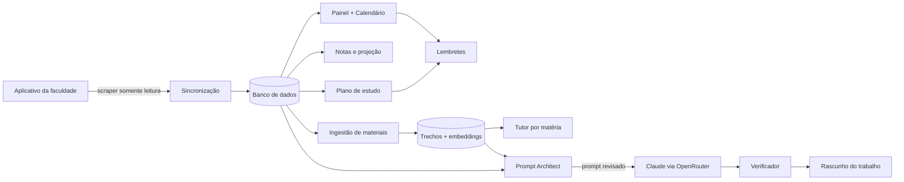

# StudyPilot — Briefing inicial do plano

> **Status:** rascunho para revisão · **Data:** 2026-10-09 · **Nome:** provisório
> **Equipe (conforme PDF do G2):** Gustavo Peixoto Siriacov, Tales Ivaniski Galina, Lorenzo Ruggini Lindemann
> **Documento seguinte:** [`2026-10-09-studypilot-sdd-design.md`](./2026-10-09-studypilot-sdd-design.md) (SDD completo)

Este briefing mapeia **tudo** o que vamos fazer, em alto nível, para alinhar escopo antes do SDD detalhado. Ele
responde: o que é, para quem, o que entra, em que ordem, o que ainda não sabemos e o que precisamos de vocês.

---

## 1. Resumo

1. A faculdade tem um aplicativo web onde cada **matéria** tem **trabalhos, materiais e informações de aula**.
2. O StudyPilot faz **scraping completo** dessa página (somente leitura, com a conta do próprio aluno), entende o que
   encontrou e **automatiza o estudo**: calendário interativo, lembretes, plano de estudo, controle de notas,
   assistente de trabalhos e tutor por matéria.
3. Para trabalhos que exigem produzir algo (um documento, por exemplo), uma IA barata **monta o prompt** a partir do
   enunciado + materiais da matéria, e esse prompt é enviado a um modelo forte (Claude) via **OpenRouter** para gerar
   um **rascunho** — sempre revisado por uma pessoa.
4. Tudo fica **num lugar só**, com back-end e banco de dados próprios, até o **deploy**.
5. Em paralelo, na branch **`dart`**, fazemos o **entregável da disciplina** (Projeto G2): um sistema simples, web,
   **100% Dart**. Ele é o que será entregue; **não é** o que vamos usar no dia a dia.

## 2. Dois projetos, duas trilhas

| | **Trilha A — StudyPilot** (a ferramenta real) | **Trilha B — Entregável G2** (branch `dart`) |
|---|---|---|
| Objetivo | Automatizar o estudo a partir dos dados reais da faculdade | Cumprir o Projeto G2 da disciplina |
| Fonte de dados | Scraping da página da faculdade | Cadastro manual pelo usuário |
| Stack | TypeScript (Next.js + worker Playwright + Postgres) | Dart: Flutter Web + servidor Shelf + SQLite |
| Onde mora | `main` | `dart` (**nunca** é mergeada em `main`) |
| Uso | Diário, por nós | Entrega e avaliação |
| Spec | Este briefing + SDD | [`dart-entregavel-design`](https://github.com/lorenzo265/trabalho_des_web/blob/dart/docs/superpowers/specs/2026-10-09-dart-entregavel-design.md) (existe só na branch `dart`) |

**O que as trilhas compartilham:** só ideias e contratos — o *prompt do "Professor Tutor"*, o contrato de streaming
do chat e o desenho do modelo de dados (a Trilha B é um subconjunto da A). Código não é compartilhado: linguagens
diferentes.

> Nota sobre o nome da branch: pedimos `.dart`, mas o git **proíbe** nomes de ref começando com ponto. Usamos `dart`.

## 3. Problema e público

- **Problema:** informação acadêmica espalhada (prazos em um lugar, materiais em outro, notas em outro), sem visão
  consolidada do que fazer *hoje*. Resultado: trabalhos esquecidos, estudo sem plano, notas sem projeção.
- **Público v1:** nós três (single-user por instalação). **Público v2:** colegas de turma/curso (multiusuário).
- **Persona principal:** universitário com 5–8 matérias simultâneas, que quer saber "o que eu faço hoje e por quê".

## 4. Princípios (guiam todas as decisões do SDD)

1. **Somente leitura na faculdade.** O scraper nunca envia, edita ou apaga nada na plataforma. Sem submissão automática.
2. **Fonte da verdade = faculdade.** Prazos e notas vêm do site; o usuário só complementa (esforço estimado, blocos de estudo).
3. **Humano no circuito.** IA gera rascunho e plano; o usuário revisa, edita e decide.
4. **Determinismo onde importa.** Agendar tarefas é algoritmo testável; a IA estima, explica e escreve — não decide horários.
5. **API oficial > endpoint interno > DOM.** Se a plataforma tiver API/token oficial, usamos; scraping de tela é o último recurso.
6. **Privacidade e custo desde o dia 1.** Credenciais cifradas, dados mínimos, teto de gasto de IA por usuário.
7. **YAGNI.** Entregar o ciclo "sincronizar → ver → planejar → lembrar" antes de qualquer extra.

## 5. Mapa de funcionalidades (Trilha A)

Prioridade em MoSCoW. A fase indica quando entra (ver §8).

| ID | Funcionalidade | O que faz | Prio | Fase |
|---|---|---|---|---|
| F01 | Conexão com a fonte | Login na faculdade (credenciais ou login assistido); sessão reutilizável | Must | P0–P1 |
| F02 | Sincronização completa | Matérias, trabalhos, materiais, aulas, avisos e notas → JSON normalizado → banco | Must | P1–P2 |
| F03 | Detecção de mudanças | Novo trabalho, prazo alterado, material novo, nota lançada → evento + log | Must | P2 |
| F04 | Painel unificado | "Hoje / semana", pendências por urgência, status por matéria | Must | P2 |
| F05 | Calendário interativo | Mês/semana/lista, cores por matéria, arrastar blocos de estudo, feed ICS | Must | P3 |
| F06 | Lembretes | Push (PWA) e e-mail: D-3, D-1, horas antes, resumo diário | Must | P3 |
| F07 | Notas e projeção | Média ponderada por matéria; "quanto preciso tirar na próxima" | Must | P4 |
| F08 | Plano de estudo | Agenda semanal gerada por algoritmo + estimativas de esforço da IA; replaneja ao mudar algo | Must | P4 |
| F09 | Ingestão de materiais | Baixa PDFs/slides, extrai texto, divide em trechos, gera embeddings | Should | P5 |
| F10 | Assistente de trabalhos | Prompt Architect (IA barata) → executor (Claude) → verificador → export `.docx`/`.pdf`/`.md` | Should | P5 |
| F11 | Tutor por matéria (RAG) | Chat com citações dos materiais da matéria; histórico salvo | Should | P6 |
| F12 | Contas e multiusuário | E-mail/senha + Google; isolamento por usuário; cotas de IA | Should | P2 (gate simples) / P7 (completo) |
| F13 | Flashcards e quiz | Gerados a partir dos materiais, com repetição espaçada | Could | pós-P7 |
| F14 | Resumos de aula/material | Resumo estruturado por material | Could | pós-P7 |
| F15 | Bot Telegram | Lembretes e consultas rápidas | Could | pós-P7 |
| F16 | Sync bidirecional com Google Calendar | Além do feed ICS | Could | pós-P7 |
| F17 | Timer de estudo e estatísticas | Tempo estudado por matéria | Could | pós-P7 |

**Fora do escopo (Won't, v1):** enviar trabalhos à plataforma; burlar MFA/captcha; app nativo; ler dados de outros
alunos; qualquer escrita na fonte.

## 6. Fluxo de valor

## 7. Mapeamento do PDF (Projeto G2) → funcionalidades

O PDF define a **Trilha B**. A coluna "Equivalente no StudyPilot" mostra que a B é um subconjunto da A.

| Req. do PDF | Prioridade | Recurso pedido | Equivalente no StudyPilot |
|---|---|---|---|
| RF01 | Alta | Cadastro/login e-mail+senha e Google | F12 |
| RF02 | Alta | Gestão de matérias (cores e categorias) | F02 (na B é cadastro manual) |
| RF03 | Alta | Chat com IA "Professor Tutor" | F11 |
| RF04 | Média | Checklist de tópicos e prazos por matéria | F04/F08 |
| RF05 | Média | Histórico de conversas por matéria/sessão | F11 |
| RF06 | Baixa | Dashboard de tempo de estudo e % concluído | F17 + F07 |

> **Divergência a confirmar com o professor:** o PDF fala em "dispositivos móveis (Android e iOS)". Vamos entregar
> web (Flutter Web). Flutter compila a mesma base também para mobile, então o app será **mobile-first/responsivo** para
> manter o requisito defensável.

## 8. Roadmap macro

| Fase | Entrega | Gate de saída |
|---|---|---|
| **P0** Recon e setup | Mapa da plataforma (`docs/recon/`), repo/monorepo, CI, ambiente de dev | Fluxo de login e de dados documentados |
| **P1** Scraper MVP | Login + dump JSON de matérias, trabalhos, materiais, aulas, notas; fixtures sanitizadas | Sync reproduzível; parsers testados em fixtures |
| **P2** Backend e banco | Schema, upsert idempotente, change events, API de leitura, painel básico, gate de acesso | Painel mostra dados reais; re-sync não duplica |
| **P3** Calendário e lembretes | Calendário interativo, feed ICS, push/e-mail | Lembrete real chega no celular |
| **P4** Notas e plano de estudo | Projeção de média; planner determinístico + estimativas IA | Plano sem sobreposição e respeitando prazos |
| **P5** Materiais e assistente de trabalhos | Ingestão + Prompt Architect → Claude → verificador → export | Um trabalho real vira rascunho exportado |
| **P6** Tutor RAG | Chat por matéria com citações e histórico | Respostas citam trecho real do material |
| **P7** Hardening e deploy | Multiusuário, cotas, backups, observabilidade, deploy em produção | Produção estável; restore de backup testado |

**Trilha B (`dart`)** corre em paralelo, no ritmo dos 6 sprints semanais do PDF (concepção → autenticação → banco →
matérias/cronograma → IA → testes/entrega). Detalhe na spec da branch `dart`.

Dependência crítica: **P0 precisa do link e do acesso** à plataforma. Até lá, a Trilha B e o desenho do SDD andam sem
bloqueio.

## 9. Premissas e dúvidas abertas

Cada item tem um **default** adotado no SDD; basta dizer "ok" ou corrigir.

| # | Dúvida | Default assumido | Quando precisa estar resolvida |
|---|---|---|---|
| D1 | Qual é a plataforma? O PDF cita **LEX** como canal de envio — pode ser a própria plataforma-alvo (hipótese, não confirmada) | Desconhecida; resolvida no recon | P0 |
| D2 | Como é o login? Usuário/senha simples, SSO (Microsoft/Google), MFA, captcha? | Usuário/senha simples. Se houver MFA/captcha: **login assistido** (você loga uma vez num navegador e reaproveitamos a sessão) — não burlamos nada | P0 |
| D3 | Quem usa na v1? | Só vocês três, uma fonte por usuário | P2 |
| D4 | Stack da Trilha A | TypeScript (Next.js + worker Playwright + Postgres) — ver ADR-001 no SDD | Antes do P0 |
| D5 | Hospedagem | PaaS com Docker (Fly.io ou Railway), decidido no P7 com custo à vista | P7 |
| D6 | "100% Dart" significa o quê? | **Flutter Web** + servidor Dart (Shelf) + SQLite. Alternativa: Jaspr (Dart sem Flutter) | Antes da Trilha B |
| D7 | Idioma e fuso | PT-BR, `America/Sao_Paulo` | — |
| D8 | Orçamento de IA | Teto de US$ 5/usuário/mês, bloqueio duro; chave OpenRouter como segredo de ambiente | P4 |
| D9 | Política da faculdade sobre IA em trabalhos | IA gera **rascunho de apoio**; revisão humana obrigatória; aviso fixo na interface | P5 |
| D10 | Termos de uso da plataforma permitem automação de leitura da própria conta? | Assumimos uso pessoal, somente leitura e com limite de taxa — **a confirmar** | P0 |
| D11 | Visibilidade do repositório | **Privado** (fixtures podem conter dados pessoais) | Agora |

## 10. O que preciso de vocês

1. **Link da página** e o nome da plataforma (Moodle, Canvas, Blackboard, LEX, portal próprio…).
2. **Como é o login** (usuário/senha, SSO, MFA, captcha).
3. **Credenciais — não cole no chat nem commite.** Cadastrem como **segredo/variável de ambiente** no ambiente da
   sessão (menu do ambiente na barra de título da sessão → *Edit*; seção de segredos de rede se oferecida, senão
   variável de ambiente). Eu leio estes nomes: `SOURCE_BASE_URL`, `SOURCE_USERNAME`, `SOURCE_PASSWORD` (e, mais tarde,
   `OPENROUTER_API_KEY`). Uma **nova sessão** enxerga os valores.
4. **Liberar o domínio da faculdade** em *Network access → Allowed domains* do mesmo ambiente; sem isso o sandbox não
   alcança o site. Passo a passo: <https://code.claude.com/docs/en/cloud-environments#network-access>.
5. Uma descrição (ou print **sem dados pessoais**) de uma matéria real: abas, onde ficam trabalhos, materiais e notas.
6. Confirmação sobre os termos de uso (D10) e a política de IA da faculdade (D9).
7. Confirmar ou corrigir os defaults de D1–D11.

**Necessidades de ambiente (minhas):** a toolchain Dart/Flutter **não está instalada** neste sandbox; precisaremos
instalá-la (e liberar o host de download) para a Trilha B. Posso preparar um *startup hook* para isso.

## 11. Riscos principais

Detalhamento e mitigações no SDD (§16).

| Risco | Impacto | Resposta resumida |
|---|---|---|
| Layout/estrutura da página muda e quebra o scraper | Alto | Validação com schemas, fixtures, estado `degraded` e alerta; mantém último dado bom |
| MFA/captcha/bloqueio de IP de datacenter | Alto | Login assistido; modo "agente local" que roda na máquina do aluno |
| Termos de uso / LGPD | Alto | Somente leitura, dados do próprio aluno, cifra de credenciais, exclusão de conta |
| Integridade acadêmica (IA fazendo trabalho) | Médio | Rascunho de apoio, revisão humana, aviso fixo, log de prompt/modelo |
| Custo de IA descontrolado | Médio | Modelo barato para extração, cache, teto por usuário |
| Alucinação em respostas/rascunhos | Médio | RAG com citações, verificador contra checklist, marcação `[VERIFICAR]` |
| Escopo crescer demais | Médio | MoSCoW + gates por fase |

## 12. Próximos passos

1. **Vocês:** revisar este briefing e o SDD; responder D1–D11 (ou aceitar os defaults).
2. **Eu:** com o acesso liberado, executar o **P0 (recon)** e produzir `docs/recon/<plataforma>.md`.
3. **Depois da aprovação das specs:** invocar o plano de implementação (skill `writing-plans`) para a primeira fase.
4. **Trilha B:** iniciar na branch `dart` assim que a spec dela for aprovada.

> **Gate:** nenhum código, scaffold ou chamada à plataforma acontece antes da aprovação explícita destas specs.
