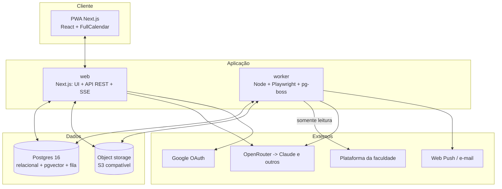
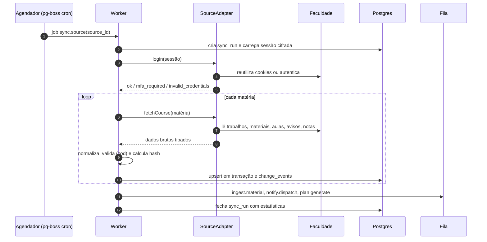
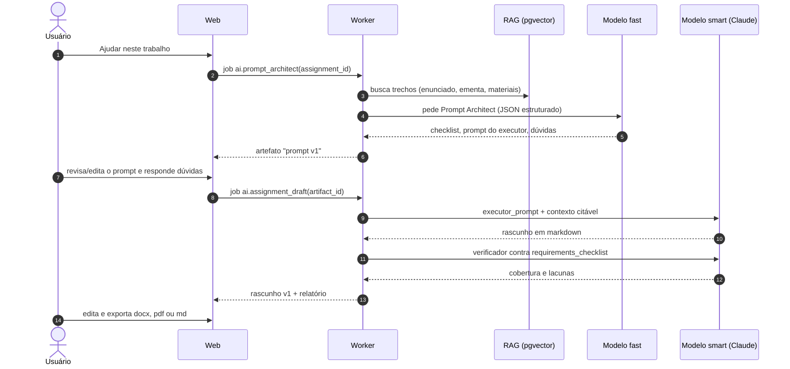
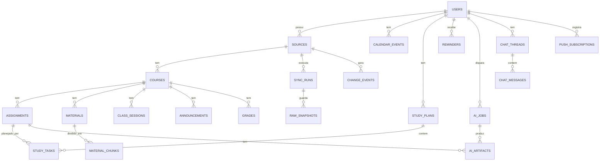

# StudyPilot — SDD (Software Design Document)

> **Status:** rascunho para revisão · **Data:** 2026-10-09 · **Versão:** 0.1
> **Pré-requisito:** [`briefing`](./2026-10-09-studypilot-briefing-design.md) (escopo, fases, dúvidas D1–D11)
> **Cobre:** requisitos → arquitetura → stack → scraper → dados → IA → API → front → segurança → testes → deploy → roadmap.

**Como ler.** Seções 1–4 dão a visão e as decisões; 5–10 detalham cada subsistema; 11–14 cobrem segurança,
operação e entrega; 15–17 trazem roadmap, riscos e decisões em aberto. Tudo que depende de ver a plataforma real
(seletores, formato exato das páginas) fica **explicitamente** atrelado ao P0 (recon) e é tratado por contrato
(interface `SourceAdapter`), não por suposição.

**Convenções.** `MUST/SHOULD/MAY` seguem a RFC 2119. Identificadores de código em inglês; texto em PT-BR.
Requisitos: `F..` (funcionais, mesmos IDs do briefing) e `N..` (não funcionais).

---

## 1. Introdução

### 1.1 Propósito
Definir como construir o StudyPilot: uma aplicação que **coleta** (somente leitura) os dados acadêmicos do aluno na
plataforma da faculdade, **normaliza e armazena** esses dados, e **automatiza o estudo** com calendário, lembretes,
notas, plano de estudo, assistente de trabalhos e tutor por matéria, usando IA via OpenRouter.

### 1.2 Escopo
Dentro: F01–F12 (Must/Should do briefing), back-end, banco, fila, armazenamento, front-end web (PWA), CI/CD e deploy.
Fora (v1): escrita na plataforma, burlar MFA/captcha, app nativo, dados de terceiros. Os "Could" (F13–F17) ficam
mapeados mas **não** detalhados aqui.

### 1.3 Glossário

| Termo | Significado |
|---|---|
| Fonte (*source*) | A plataforma da faculdade de um usuário (URL + adaptador + sessão) |
| Adaptador (*adapter*) | Módulo que sabe ler uma plataforma específica e devolve dados brutos tipados |
| Sync | Uma execução de coleta + normalização + persistência de uma fonte |
| Prompt Architect | Etapa em que um modelo barato monta o prompt do executor a partir do trabalho + contexto |
| Executor | Modelo forte (Claude) que gera o rascunho do trabalho |
| RAG | Busca de trechos dos materiais para fundamentar respostas, com citação |
| Login assistido | O usuário autentica num navegador e entregamos só a sessão resultante ao scraper |

### 1.4 Referências
PDF do Projeto G2 (Trilha B) · documentação da OpenRouter (roteamento de provedores, saídas estruturadas,
embeddings) · documentação do Playwright, pgvector e pg-boss. **Versões de bibliotecas não são fixadas neste
documento**: no scaffold usamos a versão estável corrente e travamos no lockfile.

---

## 2. Requisitos

### 2.1 Funcionais (critérios de aceite)

| ID | Requisito | Critério de aceite |
|---|---|---|
| F01 | Conectar a fonte | Dado um usuário com credenciais válidas (ou sessão assistida), `login()` retorna `ok`; credenciais inválidas retornam `invalid_credentials` sem travar; MFA/captcha retornam `mfa_required` e a UI oferece login assistido |
| F02 | Sincronização completa | Para cada matéria: trabalhos, materiais, aulas, avisos e notas são coletados, validados por schema e gravados. Rodar o sync 2× seguidas não cria duplicatas nem eventos de mudança |
| F03 | Detecção de mudanças | Alterar prazo/título/status, novo item, item removido e nota lançada geram `change_events` com diff; cada evento é notificado no máximo uma vez |
| F04 | Painel unificado | Tela inicial mostra "hoje", "próximos 7 dias", pendências ordenadas por urgência e status de sync; carrega em < 1 s (p95) com 10 matérias |
| F05 | Calendário interativo | Visões mês/semana/lista; cor por matéria; filtro por matéria/tipo; blocos de estudo arrastáveis/redimensionáveis; prazos/aulas/provas **não** editáveis; feed ICS assinável |
| F06 | Lembretes | Regras padrão D-3, D-1, 3 h antes e resumo diário 07:30; entrega por push e e-mail; sem duplicar; respeita preferências |
| F07 | Notas e projeção | Média ponderada por matéria segundo `grade_rule`; simulador responde "preciso de X na próxima avaliação" |
| F08 | Plano de estudo | Gera blocos dentro da disponibilidade, sem sobreposição, respeitando prazos quando viável; sinaliza sobrecarga; replaneja ao mudar prazos/tarefas; respeita blocos travados |
| F09 | Ingestão de materiais | PDF/DOCX/PPTX baixados, texto extraído, dividido em trechos, indexado (vetor + texto); falhas ficam visíveis e reprocessáveis |
| F10 | Assistente de trabalhos | Fluxo Prompt Architect → revisão do usuário → executor → verificador → export. Nunca submete nada à plataforma |
| F11 | Tutor por matéria | Chat com streaming, respostas fundamentadas com citações de trechos reais; histórico persistido por matéria |
| F12 | Contas | v0: acesso restrito por *allowlist* de e-mails via Google; v1: e-mail/senha + Google, isolamento total por usuário, cotas de IA |

### 2.2 Não funcionais

| ID | Requisito | Meta |
|---|---|---|
| N01 | Desempenho do sync | Sync completo de ≤ 10 matérias em ≤ 10 min; sync incremental em ≤ 3 min |
| N02 | Desempenho da UI | LCP < 2,5 s em 4G; interações do calendário < 100 ms |
| N03 | Disponibilidade | 99% mensal (esforço razoável); o app funciona com dados em cache se a fonte estiver fora |
| N04 | Segurança | Credenciais cifradas em repouso (AES-256-GCM); nenhum segredo em log/repositório; isolamento por `user_id` |
| N05 | Privacidade (LGPD) | Minimização, exportação e exclusão de conta, PII removida dos prompts, retenção definida (§11.3) |
| N06 | Custo de IA | Teto mensal por usuário com bloqueio duro; custo registrado por chamada |
| N07 | Observabilidade | Todo sync/job tem log estruturado, métrica e alerta em falha (§12) |
| N08 | Manutenibilidade | Todo parser coberto por fixtures; módulos com fronteiras claras (§3.3) |
| N09 | Acessibilidade | WCAG 2.1 AA nos fluxos principais; calendário utilizável por teclado |
| N10 | Recuperação | RPO ≤ 24 h, RTO ≤ 4 h; restore de backup testado |
| N11 | Idioma | Interface e prompts em PT-BR; fuso `America/Sao_Paulo` por padrão |

---

## 3. Arquitetura

### 3.1 Visão geral
**Monólito modular** em TypeScript com **dois processos**: `web` (UI + API) e `worker` (scraping, ingestão, IA,
notificações, agendador). Um único Postgres (relacional + vetorial + fila) e um armazenamento de objetos.
Microsserviços seriam custo sem benefício para 3–N usuários (ADR-007).



### 3.2 Fluxo de sincronização



### 3.3 Módulos e fronteiras
Cada módulo tem **um propósito**, uma interface pública e dependências explícitas — pode ser entendido e testado sem
ler o interior dos outros.

| Pacote | Propósito | Interface pública | Depende de |
|---|---|---|---|
| `packages/core` | Domínio puro: tipos, schemas zod, planner, notas, regras de lembrete | funções puras e tipos | — |
| `packages/db` | Schema, migrações, repositórios | `Repos`, `migrate()` | `core` |
| `packages/scraper` | Adaptadores + sessão + normalização | `SourceAdapter`, `runSync()` | `core` |
| `packages/ai` | `LLMClient`, `EmbeddingClient`, prompts versionados, custo | `chat()`, `stream()`, `structured()`, `embed()` | `core` |
| `packages/ingest` | Download/extração/chunking de materiais | `ingestMaterial()` | `core`, `ai` |
| `apps/web` | UI, API REST, SSE, auth | rotas HTTP | `db`, `ai`, `core` |
| `apps/worker` | Consumidores de fila, cron, notificações | handlers de job | todos |
| `tools/mock-source` | Servidor que reproduz fixtures da plataforma (dev/CI) | HTTP | — |

### 3.4 Fluxo do assistente de trabalhos



---

## 4. Tech stack e decisões (ADRs)

### 4.1 Stack

| Camada | Escolha | Motivo | Alternativa considerada |
|---|---|---|---|
| Linguagem | **TypeScript** (Node 22 LTS) ponta a ponta | Um idioma para UI, API, worker e scraper; tipos compartilhados via `core` | Python (FastAPI + Playwright + Celery) |
| Monorepo | pnpm workspaces | Simples; Turborepo só se o build ficar lento | Nx, Turborepo desde o início |
| Front-end | **Next.js** (App Router) + React + Tailwind + shadcn/ui + TanStack Query | Ecossistema maduro; SSR; PWA | SvelteKit, Vite SPA |
| Calendário | **FullCalendar** (React, plugins gratuitos) | Drag/resize, múltiplas visões, a11y razoável | react-big-calendar |
| API | Route handlers do Next.js, REST + JSON, validação com **zod**; SSE para chat | Sem serviço extra | tRPC, Fastify separado |
| Worker | Node 22 + **pg-boss** (fila/cron em Postgres) + **Playwright** + pino | Sem Redis; jobs transacionais com o banco | BullMQ + Redis |
| Banco | **PostgreSQL 16 + pgvector** | Relacional, busca vetorial e FTS (`portuguese`) num só lugar | SQLite + Chroma, Pinecone |
| ORM/migrações | **Drizzle ORM** + drizzle-kit (SQL versionado) | Tipos fortes, SQL explícito, suporte a `vector` | Prisma |
| Armazenamento | S3 compatível (Cloudflare R2/S3; MinIO no dev) | Materiais baixados e documentos gerados | Disco local (só dev) |
| IA | **OpenRouter** (API compatível com OpenAI) atrás de `LLMClient`/`EmbeddingClient` | Um endpoint, vários modelos, *fallback* e preferências de provedor | API direta da Anthropic como 2º adaptador |
| Auth | Biblioteca madura (Auth.js ou Better Auth) com Google + e-mail/senha (argon2id) | Não reinventar auth | Auth próprio |
| E-mail | Resend (ou SMTP via nodemailer); Mailpit no dev | Simples | SES |
| Push | `web-push` (VAPID) via service worker | Sem custo, nativo PWA | FCM |
| Export | `docx` (docx) e PDF via Playwright `page.pdf()` | Reaproveita o Chromium do worker | LibreOffice headless |
| Testes | Vitest, Playwright Test, Testcontainers, fast-check | Cobrem unit/integração/E2E/propriedades | Jest |
| Qualidade | ESLint + Prettier + `tsc --noEmit` | Padrão | Biome |
| CI/CD | GitHub Actions | Já no GitHub | — |
| Observabilidade | pino (JSON), página interna de status, Sentry (opcional) | Suficiente para v1 | OpenTelemetry completo |

### 4.2 ADRs (todas **Propostas** até aprovação)

**ADR-001 — TypeScript ponta a ponta.** *Contexto:* UI interativa pesada (calendário), worker com navegador, IA.
*Decisão:* TS em tudo, tipos e schemas zod compartilhados em `core`. *Consequência:* um só toolchain e menos
fricção; extração de PDF/DOCX tem boas libs em Node, mas Python seria mais forte para ML pesado (que **não**
temos). *Reversão:* o worker é um processo isolado e pode ser reescrito em Python sem tocar na UI, pois conversa
só via banco/fila.

**ADR-002 — Estratégia de coleta em três níveis.** Ordem de preferência: (1) **API oficial** da plataforma com
token (Moodle Web Services, Canvas REST etc., se for um deles); (2) **endpoints internos JSON** que o próprio
front-end da faculdade chama, usando a sessão autenticada; (3) **DOM scraping** com seletores resilientes
(papel/texto/`data-*`). Playwright é o **motor de sessão** nos três casos. *Por quê:* APIs são mais estáveis e
mais "legítimas"; DOM é o mais frágil.

**ADR-003 — Fila em Postgres (pg-boss).** Elimina Redis, dá transacionalidade com o banco (enfileirar no mesmo
commit do upsert) e cron nativo. *Limite:* throughput modesto — irrelevante aqui.

**ADR-004 — Um Postgres para tudo.** Relacional + pgvector + FTS. Menos peças para operar e backup único.

**ADR-005 — OpenRouter como gateway único, atrás de interface.** `LLMClient` isola o provedor; slugs de modelo
vêm de configuração e são **validados contra o catálogo da OpenRouter no boot** (falha rápida). Usamos
`response_format: json_schema` quando o modelo suporta e `provider.data_collection: "deny"` por padrão (ver §7.5).
Embeddings via `/api/v1/embeddings` se o modelo escolhido existir lá; senão, outro provedor atrás de
`EmbeddingClient`.

**ADR-006 — Planner determinístico; IA estima e explica.** Agendar é um problema de restrições: algoritmo
testável, barato e previsível (§8). A IA só (a) estima esforço e quebra tópicos e (b) escreve a justificativa.

**ADR-007 — Monólito modular com 2 processos.** `web` e `worker` falam por Postgres. Escala vertical basta.

**ADR-008 — Modo de execução do scraper: servidor (padrão) ou agente local.** IPs de datacenter podem ser
bloqueados e o MFA pode exigir interação. O `worker` roda em servidor por padrão; o mesmo pacote `scraper` expõe
um **CLI** (`pnpm sync --local`) que roda na máquina do aluno e grava no mesmo banco (ou gera JSON importável).
*Gatilho para usar o agente local:* bloqueio por IP ou login assistido recorrente.

**ADR-009 — Credenciais: cifra de aplicação, preferir sessão a senha.** v0: usuário/senha em variáveis de
ambiente (uma fonte, nós três). v1: guardar **apenas a sessão** (`storageState`) cifrada; se for preciso guardar
senha, cifrar com AES-256-GCM (chave `APP_ENC_KEY`, `key_id` no cabeçalho para rotação). Nunca em log.

**ADR-010 — Containers + PaaS.** Imagens Docker (`web`, `worker`), Compose no dev, PaaS (Fly.io ou Railway) em
produção, Postgres gerenciado com pgvector, R2/S3 para arquivos. Decisão final no P7 (§14).

**ADR-011 — Calendário: FullCalendar + feed ICS.** Sincronização bidirecional com Google Calendar fica fora da v1
(F16); o ICS cobre "ver no celular".

---

## 5. Módulo Scraper

### 5.1 Protocolo de reconhecimento (P0) — entrega `docs/recon/<plataforma>.md`
1. **Identificar a plataforma** (cabeçalhos, rodapé, `/login`, assets). Se for LMS conhecido, checar API/token oficial.
2. **Capturar o login** com Playwright (headed, local): campos, redirecionamentos, SSO, MFA, captcha, duração da sessão.
3. **Mapear dados**: para cada entidade (matérias, trabalhos, materiais, aulas, avisos, notas) — URL, paginação,
   carregamento tardio, se há JSON interno (aba *Network*/HAR), identificadores estáveis.
4. **Gravar HAR e trace** de uma navegação completa (local, **não** commitar).
5. **Sanitizar fixtures** (nome, matrícula, e-mail, IDs) e salvar em `packages/scraper/fixtures/<plataforma>/`.
6. **Decidir o nível da ADR-002** por entidade e registrar no recon.
7. **Checar termos de uso** (D10) e registrar a conclusão.

### 5.2 Contrato do adaptador

```ts
export type LoginResult = 'ok' | 'invalid_credentials' | 'mfa_required' | 'blocked';

export interface SourceAdapter {
  readonly id: string;                                   // ex.: 'moodle-api', 'portal-x-dom'
  login(session: SessionContext): Promise<LoginResult>;
  listCourses(): Promise<RawCourse[]>;
  fetchCourse(course: RawCourse): Promise<RawCourseDetail>; // trabalhos, materiais, aulas, avisos, notas
  openMaterial(material: RawMaterial): Promise<ReadableStream<Uint8Array>>;
}
```
`Raw*` são tipos próximos da fonte; a **normalização** (`Raw* → domínio`) vive em `core` como funções puras, validadas
por zod. Assim, trocar de plataforma = escrever outro adaptador + parsers, sem tocar no resto.

### 5.3 Identidade e idempotência
- `external_id` = ID estável da fonte. Se não existir, derivar `sha256(matéria + título normalizado + caminho da URL)`.
- Chaves únicas: `(source_id, external_id)` em matérias; `(course_id, external_id)` nas demais.
- **`content_hash`** = hash dos campos normalizados relevantes. Hash igual → nada a fazer; diferente → `updated` + diff.
- Item que sumiu da fonte → `removed` (soft: `archived`/`last_seen_at`), nunca delete físico automático.
- Upsert por matéria em **uma transação**; falha numa matéria não aborta as outras (`sync_run.status = 'partial'`).

### 5.4 Sessão e login
- Reutilizar `storageState` cifrado; só reautenticar se a sessão expirou (detectar redirecionamento ao login).
- **Login assistido:** a UI instrui o usuário a autenticar (navegador local via CLI `pnpm session:capture`), e
  recebemos só `storageState`. Não automatizamos captcha/MFA.
- Credenciais v0 vêm de `SOURCE_USERNAME`/`SOURCE_PASSWORD` (segredos de ambiente) — nunca de arquivo versionado.

### 5.5 Robustez
- **Validação por schema:** campo obrigatório ausente ou formato inesperado → erro de *drift* (não grava lixo).
- **Estado `degraded`:** ≥ 3 syncs seguidos com erro de parsing/login → `sources.status = 'degraded'`, alerta ao
  admin, e o app **mantém o último dado bom** com aviso "dados de <data>".
- **Snapshots brutos** (`raw_snapshots`) de páginas que falharam, retidos 14 dias, para depuração.
- **Seletores:** preferir papel ARIA/texto/`data-*`; evitar XPath posicional e classes geradas.
- **Politeness:** concorrência ≤ 2 páginas, atraso aleatório 300–1200 ms, `User-Agent` honesto, respeito a
  `robots.txt` quando aplicável, backoff exponencial em 429/5xx, janela de execução 07:00–23:00.
- **Agenda:** cron padrão `0 7-23/3 * * *` (6 execuções por dia, a cada 3 h, de 07:00 a 22:00) + "Sincronizar agora" com intervalo mínimo de 10 min
  (`SYNC_MIN_INTERVAL_MIN`).
- **Orçamento de tempo:** timeout por página 30 s, por sync 15 min.

### 5.5.1 Download de materiais
Somente URLs sob o host da fonte (anti-SSRF); limite de 50 MB; checagem de `Content-Type`; salvar em
`materials/<source>/<course>/<hash>`; deduplicar por hash; nada é executado, só extraído (§7.2).

### 5.6 Eventos de mudança
| Evento | Gatilhos |
|---|---|
| `assignment.created` | Notificar; gerar esforço estimado; replanejar |
| `assignment.due_changed` | Notificar com destaque; replanejar; atualizar lembretes |
| `assignment.status_changed` | Atualizar painel; cancelar lembretes se `entregue` |
| `material.created` | Enfileirar ingestão (F09); notificar |
| `grade.posted` | Notificar; recalcular projeção |
| `announcement.created` | Notificar |
| `course.removed` | Arquivar; avisar |

---

## 6. Modelo de dados

DDL completa no **Apêndice B**. Visão:



### 6.1 Regras de modelagem
- **Chave primária UUID**; todo dado de usuário alcança `user_id` por JOIN curto (via `source → user`) ou coluna direta.
- **Isolamento:** toda consulta do `web` é escopada por `user_id`; em P7 adicionamos **Row-Level Security** do
  Postgres como segunda barreira.
- **Dados da fonte vs. dados locais:** colunas vindas da faculdade são sobrescritas pelo sync; colunas locais
  (`effort_minutes`, `grade_rule`, `color`, notas do usuário) **nunca** são sobrescritas pelo sync.
- **Datas** em `timestamptz` (UTC); exibição no fuso do usuário.
- **Dimensão do vetor** parametrizada pelo modelo de embedding (padrão 1536; muda por migração se o modelo mudar).
- **Índices:** parciais para pendências e lembretes não enviados; HNSW (cosseno) em `embedding`; GIN no `tsv`.

### 6.2 Retenção
| Dado | Retenção |
|---|---|
| `raw_snapshots` | 14 dias |
| `sync_runs` | 180 dias |
| `ai_jobs` (metadados/custo) | 12 meses |
| `chat_*`, `ai_artifacts` | até o usuário apagar (ou exclusão de conta) |
| Materiais baixados | enquanto a matéria existir para o usuário |

---

## 7. Camada de IA

### 7.1 Papéis de modelo
Configuração por papel (não por tarefa), sobrescrevível por env:

| Papel | Uso | Perfil |
|---|---|---|
| `fast` | Estimar esforço, quebrar tópicos, justificativa do plano, Prompt Architect, resumos | Modelo barato e rápido (família Haiku ou equivalente) |
| `smart` | Rascunho do trabalho, verificador, tutor | Modelo forte (família Sonnet/Opus ou equivalente) |
| `embed` | Embeddings de trechos e consultas | Modelo de embedding |

Slugs exatos vêm de `LLM_MODEL_FAST`, `LLM_MODEL_SMART`, `LLM_MODEL_EMBED` e são validados no boot. Se a avaliação
(§13.5) mostrar que o Prompt Architect no `fast` é fraco, sobe-se para `smart` por configuração.

### 7.2 Ingestão de materiais (F09)
1. Baixar (§5.5.1) → 2. Extrair texto por tipo (PDF: pdf.js/unpdf; DOCX: mammoth; PPTX: leitura do XML dos slides;
links/vídeos: só metadados) → 3. Limpar (cabeçalhos/rodapés repetidos, hifenização) → 4. **Dividir em trechos** de
~500–800 tokens com sobreposição ~10%, preservando página/slide → 5. Gerar embeddings em lote → 6. Gravar
`material_chunks`. OCR de PDFs escaneados fica **fora da v1** (marcar `skipped` com motivo). Parsers rodam como
usuário sem privilégios, com limite de tamanho e timeout.

### 7.3 Prompt Architect (F10)
Entrada: enunciado, anexos extraídos, ementa/plano de ensino, rubrica (se houver), top-k trechos de materiais
(busca híbrida), preferências do usuário (formato, extensão, norma de citação). Saída **estruturada** (zod +
`response_format: json_schema`; 1 retentativa com a mensagem de erro de validação):

```ts
const PromptArchitectOutput = z.object({
  task_summary: z.string(),
  deliverable: z.object({
    format: z.enum(['docx', 'pdf', 'md', 'code', 'slides', 'other']),
    length: z.string(),                       // ex.: "4–6 páginas"
    language: z.literal('pt-BR'),
    citation_style: z.enum(['ABNT', 'APA', 'none']),
    sections: z.array(z.string()),
  }),
  requirements_checklist: z.array(z.object({
    id: z.string(),                           // "R1"
    text: z.string(),
    source: z.enum(['enunciado', 'rubrica', 'professor', 'inferido']),
    must: z.boolean(),
  })),
  context_used: z.array(z.object({
    material_id: z.string().uuid(),
    chunk_ids: z.array(z.string().uuid()),
    why: z.string(),
  })),
  executor_prompt: z.object({ system: z.string(), user: z.string() }),
  open_questions: z.array(z.string()),
  risks: z.array(z.string()),
});
```
**Regras do prompt do executor** (impostas no *template* do Architect): citar apenas o contexto fornecido, não
inventar referências, marcar fatos incertos com `[VERIFICAR]`, seguir o checklist, entregar em markdown com as
seções pedidas.

### 7.4 Executor e verificador
- **Executor** (`smart`): recebe `executor_prompt` **após revisão do usuário** + trechos citáveis; gera markdown.
- **Verificador** (`smart`): recebe rascunho + `requirements_checklist`; devolve `{coverage, missing[], issues[]}`.
  No máximo **1 ciclo automático** de revisão; depois, decisão do usuário.
- **Artefatos versionados** (`ai_artifacts`): `prompt` → `draft_md` → `verify_report` → `docx|pdf`. O log registra
  modelo, versão do prompt e custo; o export pode incluir uma nota de transparência (configurável).
- **Guard-rails de produto:** o app **não** possui ação de envio à plataforma; a UI exibe aviso fixo ("rascunho de
  apoio — revise, entenda e entregue em suas palavras; confira a política de IA da sua instituição").

### 7.5 Segurança de IA
- **Conteúdo raspado é não confiável (prompt injection).** Enunciados/materiais podem conter instruções. Todo
  contexto entra em blocos delimitados marcados como *dados*; o executor **não tem ferramentas** (só texto);
  o *system prompt* declara que instruções dentro do contexto devem ser ignoradas; saída é sempre renderizada
  com sanitização.
- **PII:** antes de chamar o LLM, remover nome completo, matrícula, e-mail e CPF (`scrubPII()` em `packages/ai`).
- **Provedores:** enviar `provider: { data_collection: "deny" }` por padrão e `require_parameters: true` quando
  usar `json_schema`; `zdr: true` opcional por configuração. *(Validar o comportamento exato na doc da OpenRouter
  durante o P4 — as opções existem, mas a política efetiva depende do provedor roteado.)*
- **Custo:** cada chamada grava `tokens_in/out` e `cost_usd` (campo `usage` da resposta) em `ai_jobs`;
  `AI_MONTHLY_BUDGET_USD` com bloqueio duro e aviso em 80%; cache de respostas determinísticas (estimativas) por hash.

### 7.6 Tutor por matéria (F11)
- **Recuperação híbrida:** vetor (cosseno) + FTS `portuguese`, fusão por *reciprocal rank*, top-k = 6–8,
  restrita à matéria (ou a todas, se o usuário escolher).
- **Prompt "Professor Tutor":** persona pedagógica, PT-BR, explica → exemplifica → verifica entendimento; cita
  trechos como `[M12·p3]`; admite quando o material não cobre; respostas curtas por padrão. O mesmo texto-base é
  usado na Trilha B.
- **Streaming (SSE):** eventos `token` (`{"t": "..."}`), `citations`, `done`, `error`.
- **Histórico:** `chat_threads/chat_messages`; contexto = últimas N mensagens + resumo das anteriores (resumo gerado
  pelo `fast` quando o histórico passa de um limite).

---

## 8. Planejador de estudo (F08) e notas (F07)

### 8.1 Entradas
Tarefas (trabalhos pendentes + provas) com `due_at`, peso `W` (se conhecido; senão padrão por tipo),
esforço `E` em minutos (IA → usuário pode editar; padrão por tipo se a IA não estimou); disponibilidade semanal
(janelas por dia da semana) menos eventos ocupados (aulas, eventos personalizados); horizonte (28 dias);
parâmetros: bloco mínimo 25 min, máximo 120 min, teto diário, folga antes do prazo (24 h; 48 h para provas).

### 8.2 Algoritmo (determinístico)
1. Montar a grade de *slots* de 15 min no horizonte = disponibilidade − ocupados.
2. Ordenar tarefas por **prazo mais próximo** (EDF); desempate por **menor folga** (`slots livres até o prazo − E`)
   e depois por peso.
3. Alocar blocos **do presente para frente**, **espalhando** em dias distintos (no máximo 1 bloco/dia/tarefa, a menos
   que a folga exija mais), para evitar acúmulo na véspera.
4. Para provas, adicionar **blocos de revisão espaçada** em D-7, D-3 e D-1 (30–45 min), se couberem.
5. Se uma tarefa não couber até `due_at − folga`, marcar **sobrecarga** com o déficit em horas e sugerir ações
   (liberar horas, reduzir escopo, priorizar).
6. **Estabilidade:** blocos `locked` ou concluídos nunca se movem; ao replanejar, manter blocos inalterados quando
   possível (minimizar *churn*).
7. **Gatilhos de replanejamento:** prazo alterado, nova tarefa, bloco perdido/atrasado, mudança de disponibilidade.

**Papel da IA:** estimar `E`, listar tópicos de uma prova (a partir da ementa/materiais) e escrever `rationale_md`.
Nunca define horários.

### 8.3 Propriedades testáveis (fast-check)
Sem sobreposição · todo bloco dentro de uma janela de disponibilidade · soma dos blocos de uma tarefa ≤ `E` (+
revisões) · prazos respeitados quando há solução viável · idempotência (replanejar sem mudanças = mesmo plano) ·
blocos `locked` intactos.

### 8.4 Notas
`grade_rule` por matéria: `{ type: 'weighted' | 'mean' | 'custom', items: [...], pass_score: 6.0 }`
(`pass_score` configurável; padrão 6,0). Fórmulas `custom` usam um avaliador de expressões **seguro** (sem
`eval`). Simulador: dado o conjunto de notas lançadas e as pendentes, calcula a nota necessária para atingir
`pass_score` e indica "inalcançável" quando aplicável.

---

## 9. API, jobs e eventos

### 9.1 Rotas REST (JSON, zod, escopadas por usuário)

| Grupo | Rotas |
|---|---|
| Fontes | `GET /api/sources` · `POST /api/sources` · `POST /api/sources/:id/sync` (429 se < intervalo mínimo) · `GET /api/sources/:id/runs` · `DELETE /api/sources/:id` |
| Matérias | `GET /api/courses` · `GET /api/courses/:id` (inclui trabalhos, materiais, aulas, avisos, notas) · `PATCH /api/courses/:id` (cor, `grade_rule`) |
| Trabalhos | `GET /api/assignments?status=&from=&to=` · `PATCH /api/assignments/:id` (`effort_minutes`, anotações locais) |
| Materiais | `GET /api/materials/:id/download` (URL assinada) · `POST /api/materials/:id/reingest` |
| Calendário | `GET /api/calendar/events?from=&to=` · `POST/PATCH/DELETE /api/calendar/events/:id` (só `editable`) · `GET /api/calendar/feed/:token.ics` |
| Notas | `GET /api/grades/summary` · `PUT /api/courses/:id/grade-rule` · `POST /api/grades/simulate` |
| Plano | `GET /api/plan` · `POST /api/plan/regenerate` · `PATCH /api/plan/tasks/:id` (mover/travar/status) · `PUT /api/me/availability` |
| Assistente | `POST /api/assignments/:id/helper` · `GET /api/assignments/:id/helper` · `PUT /api/ai/artifacts/:id` · `POST /api/ai/artifacts/:id/execute` · `POST /api/ai/artifacts/:id/export?format=docx\|pdf\|md` |
| Chat | `GET /api/chats` · `POST /api/chats` · `GET /api/chats/:id/messages` · `POST /api/chats/:id/messages` (SSE) · `DELETE /api/chats/:id` |
| Notificações | `POST /api/push/subscribe` · `PUT /api/me/notification-prefs` |
| Operação | `GET /api/healthz` · `GET /api/ops/status` (admin) |

Erros seguem `{ error: { code, message, details? } }` com códigos HTTP corretos. Paginação por cursor nas listas longas.

### 9.2 Jobs (pg-boss)

| Fila | Gatilho | Observações |
|---|---|---|
| `sync.source` | cron por fonte + manual | Exclusivo por fonte (`singletonKey = source_id`) |
| `ingest.material` | `material.created` / reingest | Retentativas com backoff; estado em `materials.ingest_status` |
| `ai.effort` | `assignment.created` | Cache por hash do enunciado |
| `plan.generate` | mudanças relevantes | Debounce de 60 s por usuário |
| `ai.prompt_architect` / `ai.assignment_draft` | ação do usuário | Idempotentes por `artifact_id` |
| `notify.scan` | cron a cada 5 min | Seleciona `reminders` vencidos e não enviados |
| `notify.dispatch` | `notify.scan`/eventos | Push e e-mail; marca `sent_at` |
| `maintenance.cleanup` | cron diário | Retenção (§6.2) e arquivos órfãos |

Todo job: **idempotente**, com `job_id` no log, retentativa limitada e *dead-letter* visível em `/ops`.

---

## 10. Front-end

### 10.1 Mapa de telas
Painel (hoje/semana) · Calendário · Matérias (lista) → Matéria (abas: Trabalhos, Materiais, Aulas, Avisos, Notas,
Tutor) · Plano de estudo · Assistente de trabalho (wizard: contexto → prompt → rascunho → export) · Notas/Simulador ·
Configurações (fonte, disponibilidade, notificações, orçamento de IA, conta) · Operação/Status (admin).

### 10.2 Calendário (F05)
- Camadas por tipo (`aula`, `prazo`, `prova`, `estudo`, `custom`) com legenda e filtro; cor por matéria.
- **Editáveis** apenas `estudo` e `custom` (arrastar/redimensionar → `PATCH`, marca bloco como `locked`).
  Prazos/aulas/provas são somente leitura (fonte da verdade = faculdade).
- Feed ICS por token aleatório e revogável (`calendar_feed_token`), com `VALARM` opcional.
- Teclado: navegação por setas, atalhos para trocar visão; contraste AA nas cores por matéria.

### 10.3 PWA e notificações
`manifest` + service worker; *opt-in* explícito de push; preferências por canal e horário silencioso. Cache
*stale-while-revalidate* para o painel (N03).

### 10.4 Estados e UX
Todo dado mostra "atualizado há X" (frescor do sync); erros de fonte aparecem como faixa não bloqueante; estados
vazios guiam a próxima ação; o aviso de integridade acadêmica é permanente no fluxo do assistente.

---

## 11. Segurança e privacidade

### 11.1 Modelo de ameaças (resumo)

| Ameaça | Controle |
|---|---|
| Vazamento de credenciais/sessão da faculdade | AES-256-GCM com `APP_ENC_KEY` fora do banco; preferir só sessão; rotação por `key_id`; nunca em log |
| XSS vindo de conteúdo raspado | Tratar tudo como não confiável; sanitizar HTML/markdown; CSP restritiva |
| *Prompt injection* em enunciados/materiais | Delimitar contexto como dados; executor sem ferramentas; sanitizar saída (§7.5) |
| SSRF no download de materiais | Somente host da fonte; bloquear IPs privados/loopback; limite de tamanho/redirecionamentos |
| IDOR / vazamento entre usuários | Escopo por `user_id` em toda consulta; RLS no P7; testes de isolamento |
| Força bruta / abuso | *Rate limit* por IP/usuário; bloqueio progressivo; limite no sync manual e nas chamadas de IA |
| CSRF | Cookies `SameSite=Lax` + `HttpOnly` + `Secure`; checagem de `Origin` |
| Token do feed ICS vazado | Token de 256 bits, revogável; só leitura |
| Supply chain | Lockfile, Dependabot, imagens base fixadas, `pnpm audit` no CI |
| Parsers de arquivo (PDF/DOCX) | Usuário sem privilégios, limites de tamanho/tempo, sem execução de conteúdo |

### 11.2 Segredos
Somente variáveis de ambiente/segredos da plataforma (Apêndice C). `.env*` no `.gitignore`; hook de *pre-commit* e
varredura de segredos no CI. **Fixtures e HAR** podem conter dados pessoais: sanitizar antes de commitar; HAR/trace
brutos nunca entram no repositório; repositório **privado**.

### 11.3 LGPD
Base legal: **consentimento** do titular (o próprio aluno) para tratar os próprios dados acadêmicos. Princípios:
finalidade única (apoio ao estudo), minimização (só campos usados), transparência (tela "o que coletamos"),
**direitos do titular** (exportar JSON, excluir conta com remoção em cascata de dados e arquivos), retenção
(§6.2). O provedor de IA é operador: PII removida do prompt e `data_collection: "deny"`.

### 11.4 Termos de uso da fonte e integridade acadêmica
Uso pessoal, somente leitura e com limite de taxa; sem contornar autenticação forte; confirmar os termos (D10) no P0
e **parar** se proibirem automação. O assistente de trabalhos é "apoio ao estudo" com revisão humana obrigatória.

---

## 12. Observabilidade e operação

- **Logs:** pino em JSON, com `request_id`, `sync_run_id`, `job_id`, `user_id`; *redaction* de campos sensíveis.
- **Métricas (consultáveis em `/ops`):** idade do último sync bem-sucedido; taxa de falha de parsing por entidade;
  profundidade e atraso das filas; custo de IA/dia e por usuário; latência p95 da API; tamanho do banco.
- **Alertas** (e-mail/push ao admin): sync falhou 3× seguidas; nenhum sync OK em 24 h; *drift* de parser; gasto de IA
  ≥ 80% do orçamento; fila com *dead-letter*; falha de backup.
- **Healthchecks:** `/api/healthz` (liveness) e verificação de banco/fila (readiness).
- **Runbooks curtos** em `docs/runbooks/`: "sync quebrou", "restaurar backup", "rotacionar APP_ENC_KEY", "revogar feed ICS".

---

## 13. Estratégia de testes

### 13.1 Pirâmide
| Nível | Ferramenta | O que cobre |
|---|---|---|
| Unitário | Vitest | `core` (normalização, notas, regras de lembrete), `ai` (templates, PII, custo) |
| Parsers | Vitest + fixtures | Cada parser: `fixture → JSON normalizado esperado` (*snapshot* revisado) |
| Propriedades | fast-check | Invariantes do planner (§8.3) |
| Integração | Testcontainers (Postgres+pgvector) | Upsert idempotente, `change_events`, filas, RLS, busca híbrida |
| E2E | Playwright Test | Fluxos de UI contra o **`mock-source`** (sem credenciais reais) |
| Avaliação de IA | Script de *evals* | Ver §13.5 |

### 13.2 `tools/mock-source`
Servidor HTTP que **reproduz as fixtures** (login, listagens, downloads) — permite testar o adaptador e o E2E inteiro
em CI sem tocar na faculdade, e simular *drift* (campo removido) e falhas (429, sessão expirada).

### 13.3 Teste ao vivo
`pnpm test:live` roda contra a plataforma real com credenciais do ambiente. É **manual**, nunca no CI, e só lê.

### 13.4 Portões de CI
`lint` + `typecheck` + unitários + parsers + integração + build das imagens. PR só funde se tudo passar; cobertura
mínima de **100% das fixtures por parser** e ≥ 80% de linhas em `core`.

### 13.5 Avaliação de IA
Conjunto dourado de ~10 trabalhos/enunciados (sanitizados): taxa de saída válida pelo schema ≥ 98%; cobertura do
checklist pelo verificador; custo médio por fluxo; ausência de referências inventadas (amostragem manual).
Respostas gravadas (modo *replay*) em testes unitários; chamadas reais só no job de *evals*.

---

## 14. Ambientes, CI/CD e deploy

### 14.1 Ambientes
| Ambiente | Para quê | Como sobe |
|---|---|---|
| **local** | Desenvolvimento | `docker compose up` (Postgres+pgvector, MinIO, Mailpit) + `pnpm dev` |
| **prod** | Uso real | Imagens `web` e `worker` no PaaS + Postgres gerenciado + R2/S3 |
| *(staging)* | Opcional após o P7 | Mesmo pipeline, outro projeto |

### 14.2 Imagens
- `web`: Node 22 *slim*, multi-stage, `next build` com saída *standalone*, usuário não-root.
- `worker`: base **oficial do Playwright** com a **mesma versão** da dependência (tag fixada), usuário não-root,
  `shm_size` adequado; Chromium com 1 contexto por sync.
- Ambas com `HEALTHCHECK` e variáveis só em tempo de execução.

### 14.3 Pipeline (GitHub Actions)
1. **CI** (em PR): instalar (cache pnpm) → lint → typecheck → testes (Postgres como *service container*) → build.
2. **Release** (merge em `main` ou tag): construir e publicar imagens (GHCR) → **migrar o banco** (`drizzle-kit
   migrate`) como passo de release → promover `web` e `worker` → *smoke test* em `/api/healthz`.
3. **Rollback:** redeploy da imagem anterior. Migrações **só avançam** (padrão *expand/contract*: adicionar →
   migrar dados → remover depois), para que a versão anterior continue compatível.

### 14.4 Hospedagem (recomendação, a decidir no P7)
- **Preferida:** PaaS com Docker — **Fly.io** ou **Railway** (2 serviços: `web`, `worker`), Postgres gerenciado com
  pgvector (ex.: Neon/Supabase/Railway), **Cloudflare R2** para arquivos, domínio com TLS gerenciado.
- **Alternativa barata/portátil:** uma VPS pequena com Docker Compose + Caddy (TLS automático). Mesmas imagens.
- **Critérios de decisão no P7:** suporte a pgvector no Postgres gerenciado, RAM do worker (Chromium ≈ 1 GB),
  facilidade de segredos, custo mensal total (incluindo IA, que é a variável dominante).

### 14.5 Backups e recuperação
`pg_dump` diário para o armazenamento de objetos (retenção 14 dias) + *point-in-time* se o provedor oferecer;
**teste de restauração** mensal documentado em runbook (N10). Rotação de `APP_ENC_KEY` e dos tokens como rotina.

### 14.6 Configuração
Variáveis de ambiente no Apêndice C; `env.ts` valida tudo com zod no boot e **falha rápido** se faltar algo.

---

## 15. Roadmap detalhado

Cada fase termina com um **gate**; só começamos a próxima com o gate cumprido. *Definição de pronto:* testes
passando no CI, docs/runbook atualizados, sem segredo no repositório.

**P0 — Recon e setup** *(precisa do link/acesso)*
- Executar o protocolo §5.1 e escrever `docs/recon/<plataforma>.md` (sem dados pessoais).
- Criar o monorepo (pnpm), `core`, CI, `docker-compose.yml`, `env.ts`, ESLint/Prettier, hooks de segredo.
- Fixar a estratégia ADR-002 por entidade.
- **Gate:** recon aprovado; `pnpm ci` verde no esqueleto.

**P1 — Scraper MVP**
- `SourceAdapter` da plataforma real + login + sessão cifrada; `runSync()` produz JSON normalizado em disco.
- Fixtures sanitizadas + testes de parsers + `mock-source`.
- **Gate:** sync repetível de todas as matérias; testes de parser verdes.

**P2 — Backend e banco**
- Schema (Apêndice B) + migrações; upsert idempotente; `change_events`; `sync_runs`; API de leitura; painel básico.
- Gate de acesso (allowlist Google). `pg-boss` com cron do sync.
- **Gate:** painel mostra dados reais; re-sync não duplica nem gera eventos falsos.

**P3 — Calendário e lembretes**
- `calendar_events` (aulas/prazos/provas); FullCalendar; feed ICS; `reminders` + `notify.*`; PWA/push + e-mail.
- **Gate:** lembrete real recebido no celular; feed ICS aberto no Google Calendar.

**P4 — Notas e plano de estudo**
- `grade_rule` + simulador; estimativa de esforço (`ai.effort`); planner determinístico + testes de propriedade; UI do plano.
- `LLMClient` + registro de custo + orçamento.
- **Gate:** plano sem sobreposição e respeitando prazos; sobrecarga sinalizada; custo registrado.

**P5 — Materiais e assistente de trabalhos**
- Ingestão (§7.2) com busca híbrida; Prompt Architect → revisão → executor → verificador → export docx/pdf/md.
- Conjunto dourado de *evals*.
- **Gate:** um trabalho real vira rascunho exportado, com checklist coberto e custo logado.

**P6 — Tutor RAG**
- Chat com SSE, citações e histórico; persona "Professor Tutor"; resumo de histórico longo.
- **Gate:** respostas citam trechos reais; recusa quando o material não cobre.

**P7 — Hardening e deploy**
- Auth completo (e-mail/senha + Google), multiusuário, RLS, cotas; observabilidade e alertas; backups e teste de restore.
- Escolha final de hospedagem (§14.4), pipeline de release, runbooks, revisão de segurança.
- **Gate:** produção estável por 1 semana; restore testado; checklist de segurança fechado.

**Trilha B (`dart`)** corre em paralelo — ver spec da branch.

---

## 16. Riscos e mitigações

| # | Risco | Prob. | Impacto | Mitigação | Gatilho |
|---|---|---|---|---|---|
| R1 | Estrutura da página muda | Alta | Alto | Schemas, fixtures, `degraded`, último dado bom, alerta | Erro de *drift* |
| R2 | MFA/captcha/bloqueio de IP | Média | Alto | Login assistido; agente local (ADR-008) | `mfa_required`/`blocked` |
| R3 | Termos de uso proíbem automação | Média | Alto | Checar no P0; usar API oficial; parar se proibido | Cláusula no termo |
| R4 | Vazamento de credenciais | Baixa | Alto | AES-GCM, sessão em vez de senha, segredos fora do repo | Auditoria/segredo exposto |
| R5 | Prompt injection via conteúdo raspado | Média | Médio | Delimitação, executor sem ferramentas, sanitização | Saída anômala |
| R6 | Alucinação / referências inventadas | Alta | Médio | RAG com citação, `[VERIFICAR]`, verificador, revisão humana | Evals |
| R7 | Custo de IA | Média | Médio | `fast` por padrão, cache, teto duro | 80% do orçamento |
| R8 | Integridade acadêmica | Média | Médio | Rascunho de apoio, aviso fixo, log de prompt/modelo | Política da faculdade |
| R9 | Qualidade da extração de PDFs (escaneados, tabelas) | Média | Médio | Marcar `skipped`, OCR pós-v1, mostrar status | Muitos `skipped` |
| R10 | Scope creep | Média | Médio | MoSCoW, gates por fase, YAGNI | Item "Could" entrando cedo |
| R11 | Chromium pesado no PaaS | Média | Baixo | 1 contexto/sync; RAM ≥ 1 GB; agente local como saída | OOM no worker |
| R12 | Dívida de migração de embeddings (trocar modelo) | Baixa | Médio | Dimensão parametrizada; reindexação por job | Troca de modelo |

---

## 17. Decisões em aberto

Além de D1–D11 do briefing:

| # | Decisão | Default | Quando |
|---|---|---|---|
| D12 | Modelo e dimensão de embeddings | 1536, via OpenRouter se disponível | P5 |
| D13 | Biblioteca de auth (Auth.js vs Better Auth) | Avaliar no P2; decisão final no P7 | P2/P7 |
| D14 | Provedor de hospedagem (Fly.io vs Railway vs VPS) | PaaS com Docker | P7 |
| D15 | Provedor de e-mail (Resend vs SMTP) | Resend | P3 |
| D16 | Norma de citação padrão dos trabalhos | ABNT | P5 |

---

## Apêndice A — Estrutura do repositório (`main`)

```
.
├── apps/
│   ├── web/                 # Next.js: UI + API + SSE
│   └── worker/              # pg-boss handlers + cron + Playwright
├── packages/
│   ├── core/                # domínio puro (zod, planner, notas, lembretes)
│   ├── db/                  # Drizzle schema + migrações + repositórios
│   ├── scraper/             # adaptadores, sessão, fixtures/
│   ├── ai/                  # LLMClient, EmbeddingClient, prompts, PII, custo
│   └── ingest/              # extração e chunking de materiais
├── tools/
│   └── mock-source/         # servidor que reproduz fixtures
├── docs/
│   ├── superpowers/specs/   # briefing, SDD, specs
│   ├── recon/               # mapa da plataforma (sanitizado)
│   └── runbooks/
├── .github/workflows/       # ci.yml, release.yml
├── docker-compose.yml
└── pnpm-workspace.yaml
```

## Apêndice B — DDL (PostgreSQL 16 + pgvector)

```sql
create extension if not exists vector;
create extension if not exists citext;

create table users (
  id uuid primary key default gen_random_uuid(),
  email citext not null unique,
  name text,
  password_hash text,                              -- null em contas só-Google
  google_sub text unique,
  timezone text not null default 'America/Sao_Paulo',
  weekly_availability jsonb not null default '[]', -- [{"dow":1,"start":"19:00","end":"22:00"}]
  ai_monthly_budget_usd numeric(8,2) not null default 5.00,
  calendar_feed_token text unique,
  created_at timestamptz not null default now()
);

create table sources (
  id uuid primary key default gen_random_uuid(),
  user_id uuid not null references users(id) on delete cascade,
  adapter text not null,
  base_url text not null,
  status text not null default 'pending'
    check (status in ('pending','active','degraded','auth_failed','disabled')),
  credentials_enc bytea,                           -- AES-256-GCM, nunca em claro
  session_state_enc bytea,                         -- storageState cifrado
  sync_cron text not null default '0 7-23/3 * * *',
  last_sync_at timestamptz,
  created_at timestamptz not null default now()
);

create table courses (
  id uuid primary key default gen_random_uuid(),
  source_id uuid not null references sources(id) on delete cascade,
  external_id text not null,
  code text,
  name text not null,
  teacher text,
  term text,
  syllabus_md text,
  schedule jsonb,
  color text,                                      -- local
  grade_rule jsonb,                                -- local
  archived boolean not null default false,
  content_hash text not null,
  first_seen_at timestamptz not null default now(),
  last_seen_at timestamptz not null default now(),
  unique (source_id, external_id)
);

create table class_sessions (
  id uuid primary key default gen_random_uuid(),
  course_id uuid not null references courses(id) on delete cascade,
  external_id text not null,
  starts_at timestamptz not null,
  ends_at timestamptz,
  room text,
  topic text,
  unique (course_id, external_id)
);

create table assignments (
  id uuid primary key default gen_random_uuid(),
  course_id uuid not null references courses(id) on delete cascade,
  external_id text not null,
  kind text not null check (kind in ('trabalho','prova','quiz','atividade','outro')),
  title text not null,
  description_md text,
  attachments jsonb not null default '[]',
  due_at timestamptz,
  max_points numeric(6,2),
  weight numeric(5,2),
  status text not null default 'pendente'
    check (status in ('pendente','entregue','atrasado','corrigido','dispensado')),
  submitted_at timestamptz,
  url text,
  effort_minutes integer,                          -- local
  effort_source text check (effort_source in ('ia','usuario','padrao')),
  content_hash text not null,
  first_seen_at timestamptz not null default now(),
  last_seen_at timestamptz not null default now(),
  unique (course_id, external_id)
);
create index assignments_due_pending_idx on assignments (due_at) where status = 'pendente';

create table materials (
  id uuid primary key default gen_random_uuid(),
  course_id uuid not null references courses(id) on delete cascade,
  external_id text not null,
  title text not null,
  kind text not null check (kind in ('pdf','slide','doc','link','video','outro')),
  url text,
  storage_key text,
  mime text,
  bytes bigint,
  content_hash text,
  ingest_status text not null default 'pending'
    check (ingest_status in ('pending','processing','done','skipped','failed')),
  ingest_error text,
  posted_at timestamptz,
  first_seen_at timestamptz not null default now(),
  unique (course_id, external_id)
);

create table material_chunks (
  id uuid primary key default gen_random_uuid(),
  material_id uuid not null references materials(id) on delete cascade,
  ordinal integer not null,
  page integer,
  text text not null,
  tokens integer,
  embedding vector(1536),
  tsv tsvector generated always as (to_tsvector('portuguese', text)) stored,
  unique (material_id, ordinal)
);
create index material_chunks_embedding_idx on material_chunks using hnsw (embedding vector_cosine_ops);
create index material_chunks_tsv_idx on material_chunks using gin (tsv);

create table announcements (
  id uuid primary key default gen_random_uuid(),
  course_id uuid not null references courses(id) on delete cascade,
  external_id text not null,
  title text not null,
  body_md text,
  posted_at timestamptz,
  unique (course_id, external_id)
);

create table grades (
  id uuid primary key default gen_random_uuid(),
  course_id uuid not null references courses(id) on delete cascade,
  assignment_id uuid references assignments(id) on delete set null,
  external_id text,
  label text not null,
  score numeric(6,2),
  max_score numeric(6,2) not null default 10,
  weight numeric(5,2),
  posted_at timestamptz,
  unique (course_id, external_id)
);

create table calendar_events (
  id uuid primary key default gen_random_uuid(),
  user_id uuid not null references users(id) on delete cascade,
  course_id uuid references courses(id) on delete set null,
  kind text not null check (kind in ('aula','prazo','prova','estudo','custom')),
  title text not null,
  starts_at timestamptz not null,
  ends_at timestamptz,
  all_day boolean not null default false,
  ref_type text,
  ref_id uuid,
  rrule text,
  editable boolean not null default false,
  notes text
);
create index calendar_events_user_time_idx on calendar_events (user_id, starts_at);
create unique index calendar_events_ref_uidx on calendar_events (user_id, ref_type, ref_id) where ref_id is not null;

create table study_plans (
  id uuid primary key default gen_random_uuid(),
  user_id uuid not null references users(id) on delete cascade,
  version integer not null,
  status text not null default 'active' check (status in ('active','superseded')),
  params jsonb not null,
  rationale_md text,
  generated_at timestamptz not null default now(),
  unique (user_id, version)
);

create table study_tasks (
  id uuid primary key default gen_random_uuid(),
  plan_id uuid not null references study_plans(id) on delete cascade,
  course_id uuid references courses(id) on delete set null,
  assignment_id uuid references assignments(id) on delete set null,
  kind text not null check (kind in ('trabalho','revisao','leitura','pratica')),
  title text not null,
  est_minutes integer not null check (est_minutes > 0),
  scheduled_start timestamptz,
  scheduled_end timestamptz,
  locked boolean not null default false,
  status text not null default 'todo' check (status in ('todo','doing','done','skipped')),
  completed_at timestamptz
);

create table reminders (
  id uuid primary key default gen_random_uuid(),
  user_id uuid not null references users(id) on delete cascade,
  target_type text not null,
  target_id uuid not null,
  remind_at timestamptz not null,
  channel text not null check (channel in ('push','email')),
  sent_at timestamptz,
  unique (user_id, target_type, target_id, remind_at, channel)
);
create index reminders_due_idx on reminders (remind_at) where sent_at is null;

create table ai_jobs (
  id uuid primary key default gen_random_uuid(),
  user_id uuid not null references users(id) on delete cascade,
  kind text not null check (kind in ('effort_estimate','plan_rationale','prompt_architect',
    'assignment_draft','assignment_verify','tutor_reply','embed','summary')),
  status text not null default 'queued' check (status in ('queued','running','succeeded','failed')),
  model text,
  prompt_version text,
  tokens_in integer,
  tokens_out integer,
  cost_usd numeric(10,5),
  error text,
  created_at timestamptz not null default now(),
  finished_at timestamptz
);

create table ai_artifacts (
  id uuid primary key default gen_random_uuid(),
  job_id uuid not null references ai_jobs(id) on delete cascade,
  assignment_id uuid references assignments(id) on delete set null,
  kind text not null check (kind in ('prompt','draft_md','verify_report','docx','pdf')),
  version integer not null default 1,
  content jsonb,
  storage_key text,
  created_at timestamptz not null default now()
);

create table chat_threads (
  id uuid primary key default gen_random_uuid(),
  user_id uuid not null references users(id) on delete cascade,
  course_id uuid references courses(id) on delete set null,
  title text,
  created_at timestamptz not null default now(),
  updated_at timestamptz not null default now()
);

create table chat_messages (
  id uuid primary key default gen_random_uuid(),
  thread_id uuid not null references chat_threads(id) on delete cascade,
  role text not null check (role in ('user','assistant','system')),
  content text not null,
  citations jsonb,
  model text,
  created_at timestamptz not null default now()
);
create index chat_messages_thread_idx on chat_messages (thread_id, created_at);

create table sync_runs (
  id uuid primary key default gen_random_uuid(),
  source_id uuid not null references sources(id) on delete cascade,
  trigger text not null check (trigger in ('cron','manual')),
  status text not null default 'running' check (status in ('running','succeeded','partial','failed')),
  stats jsonb,
  error text,
  started_at timestamptz not null default now(),
  finished_at timestamptz
);

create table raw_snapshots (
  id uuid primary key default gen_random_uuid(),
  sync_run_id uuid not null references sync_runs(id) on delete cascade,
  url text not null,
  kind text not null,
  storage_key text not null,
  created_at timestamptz not null default now()
);

create table change_events (
  id uuid primary key default gen_random_uuid(),
  source_id uuid not null references sources(id) on delete cascade,
  entity_type text not null,
  entity_id uuid not null,
  change_type text not null check (change_type in ('created','updated','removed')),
  diff jsonb,
  seen_at timestamptz not null default now(),
  notified_at timestamptz
);
create index change_events_pending_idx on change_events (seen_at) where notified_at is null;

create table push_subscriptions (
  id uuid primary key default gen_random_uuid(),
  user_id uuid not null references users(id) on delete cascade,
  endpoint text not null unique,
  p256dh text not null,
  auth text not null,
  created_at timestamptz not null default now()
);
```

## Apêndice C — Variáveis de ambiente

| Variável | Uso | Obrigatória |
|---|---|---|
| `DATABASE_URL` | Conexão Postgres | sim |
| `APP_BASE_URL` | URL pública (links, OAuth, ICS) | sim |
| `APP_ENC_KEY` | Chave AES-256 (32 bytes, base64) para credenciais/sessões | sim |
| `AUTH_SECRET` | Assinatura de sessões/cookies | sim |
| `GOOGLE_CLIENT_ID` / `GOOGLE_CLIENT_SECRET` | Login Google | sim |
| `ALLOWED_EMAILS` | Allowlist da v0 (lista separada por vírgula) | v0 |
| `SOURCE_BASE_URL` / `SOURCE_USERNAME` / `SOURCE_PASSWORD` | Fonte única da v0 | v0 |
| `OPENROUTER_API_KEY` | Chave da OpenRouter | P4+ |
| `LLM_MODEL_FAST` / `LLM_MODEL_SMART` / `LLM_MODEL_EMBED` | Slugs dos modelos | P4+ |
| `AI_MONTHLY_BUDGET_USD` | Teto padrão por usuário | P4+ |
| `S3_ENDPOINT` / `S3_BUCKET` / `S3_ACCESS_KEY` / `S3_SECRET_KEY` | Armazenamento de objetos | P2+ |
| `VAPID_PUBLIC_KEY` / `VAPID_PRIVATE_KEY` / `VAPID_SUBJECT` | Web Push | P3+ |
| `EMAIL_PROVIDER_KEY` (ou `SMTP_URL`) | E-mail | P3+ |
| `SYNC_MIN_INTERVAL_MIN` | Intervalo mínimo entre syncs manuais (padrão 10) | não |
| `LOG_LEVEL` / `SENTRY_DSN` | Observabilidade | não |
