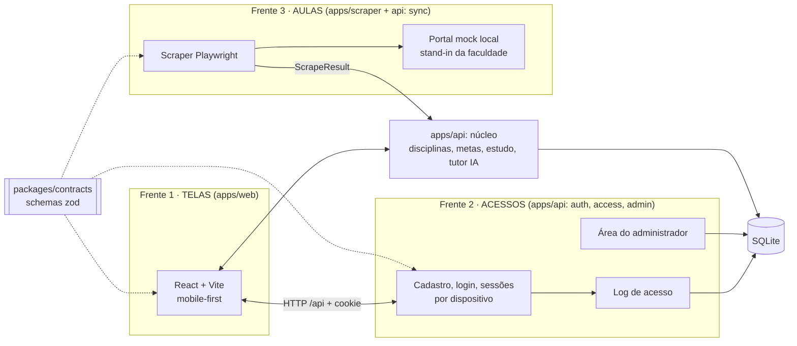
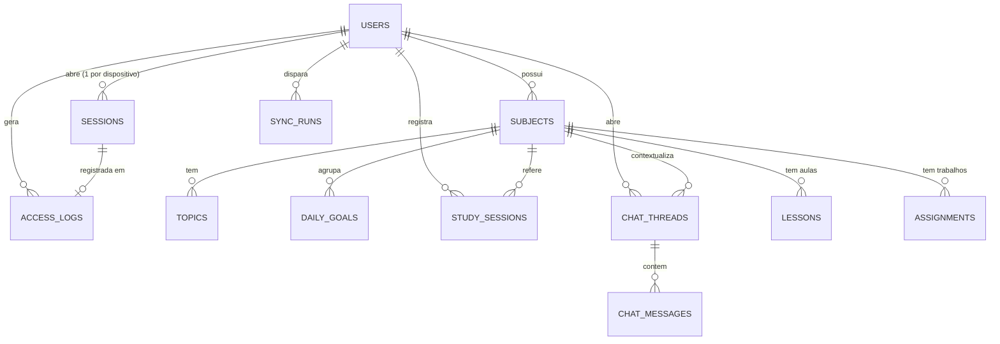
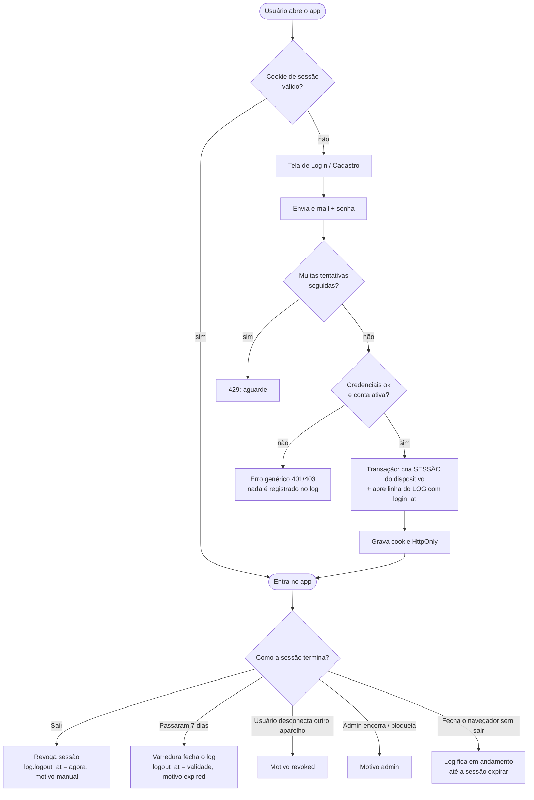
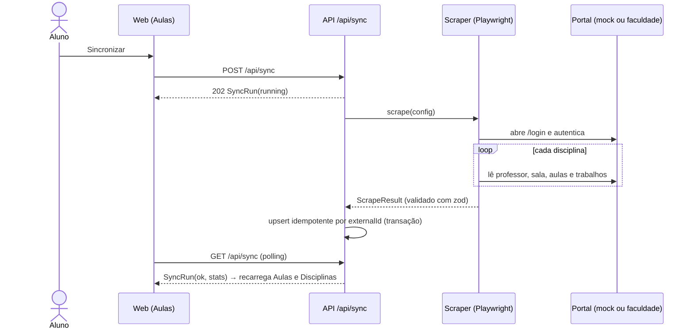

# EduMind — PoC local: estrutura e tech stack

> **Status:** proposta para revisão · **Data:** 2026-10-23 · **Escopo:** PoC simples, só `localhost`, foco no **frontend**.
> **Origem:** PDF "Projeto G2" (16/10 — protótipos das 5 telas), slides da aula de 23/10 (acesso, log, admin) e a decisão
> do grupo de **deixar o Dart de lado** e usar a stack "normal" (TypeScript).
> **Relação com os outros documentos:** este arquivo **simplifica** o [SDD](./2026-10-09-studypilot-sdd-design.md) para um
> PoC. O SDD continua sendo o destino de longo prazo (§10 mostra o caminho de escala).

## 1. O que é o PoC (e o que ele não é)

**É:** um app web para o aluno organizar os estudos — login, painel do dia, disciplinas, **Professor Tutor IA**,
progresso — que também **lê as aulas da faculdade com scrapers** e registra **quem acessou e quando** (log de acesso),
com uma área de administrador. Tudo roda na sua máquina com `npm run dev`.

**Não é (por enquanto):** nada de Docker/containers, filas, Postgres, deploy, multiusuário em produção, login com
Google, notificações push. Cada item tem um lugar reservado no §10.

**Nome do app:** **EduMind** (como no PDF da equipe). Fica em uma constante/variável (`APP_NAME`).

## 2. Divisão do projeto em três frentes

A divisão que você pediu: **telas**, **acessos do site** e **aulas (extração com scrapers)**. Cada frente tem uma
pasta, uma responsabilidade e fala com as outras **só pelos contratos** (`packages/contracts`).



| Frente | Pasta | Entrega | Telas / rotas principais |
|---|---|---|---|
| **1. Telas** | `apps/web` | Toda a interface, responsiva (celular → desktop), estados de carregando/vazio/erro | Login, Dashboard, Disciplinas, Tutor IA, Progresso, Aulas, Perfil, Admin |
| **2. Acessos** | `apps/api/src/modules/{auth,access,admin}` + telas Login/Perfil/Admin | Cadastro, login e senha, **sessão por dispositivo**, **log de acesso** (nome, data, hora de login, hora de logout), área do admin | `/api/auth/*`, `/api/me/*`, `/api/admin/*` |
| **3. Aulas** | `apps/scraper` + `apps/api/src/modules/{lessons,sync}` + tela Aulas | Scraper Playwright que lê disciplinas, aulas e trabalhos; portal mock para desenvolver sem a faculdade; botão "Sincronizar" | `/api/sync`, `/api/lessons`, `/api/assignments` |
| *Núcleo* | `apps/api/src/modules/{subjects,topics,goals,study,chat}` | Dados do estudo e o Professor Tutor | `/api/subjects`, `/api/goals`, `/api/stats/week`, `/api/chats/*` |

**Regra de fronteira:** o front só conhece `/api`; o scraper só devolve um `ScrapeResult` (formato em
`contracts/src/scrape.ts`); o backend nunca conhece seletores HTML. Trocar a fonte (mock → faculdade real) mexe
**somente** em `apps/scraper/src/adapters`.

## 3. Tech stack

| Camada | Escolha | Por quê (para um PoC) | Ao escalar (§10) |
|---|---|---|---|
| Linguagem | **TypeScript** (Node 22) em tudo | Um idioma só; tipos compartilhados | — |
| Repositório | **npm workspaces** (monorepo simples) | Sem ferramenta extra | Turborepo se crescer |
| Frontend | **React 19 + Vite + React Router** | Padrão de mercado, hot reload instantâneo | Next.js (SSR/PWA) |
| Estado do servidor | **TanStack Query** | Cache e recarga sem boilerplate | — |
| Estilo | **CSS próprio** com *design tokens* (variáveis) | Controle total do visual do protótipo, zero dependência | Tailwind/design system |
| Ícones / gráficos | **lucide-react** / **SVG feito à mão** | Ícones consagrados; gráfico de barras simples sem biblioteca | Biblioteca de gráficos |
| Markdown do chat | **react-markdown** | Seguro por padrão (sem HTML cru) | — |
| Backend | **Node + Express 5** | O "normal"; poucas peças | Fastify/NestJS se precisar |
| Validação | **zod** (em `contracts`) | Mesmo schema no front, na API e no scraper | — |
| Banco | **SQLite** via **better-sqlite3** (um arquivo, sem servidor) | Zero instalação; SQL explícito | Postgres 16 |
| Senhas / sessão | `crypto.scrypt` (nativo) + **cookie de sessão opaco**, hash no banco | Sem dependência; permite encerrar sessão e registrar logout | OAuth/Google, MFA |
| Tutor IA | **OpenRouter** via `fetch` + **SSE**; **modo demonstração** sem chave | Streaming real; funciona sem custo para demonstrar | Cotas, RAG |
| Scraper | **Playwright** (`playwright-core`, Chromium) | Lê páginas com login e JavaScript | Worker + fila (pg-boss) |
| Testes | **Vitest** (+ Supertest na API, Testing Library no web) | Rápido, mesmo runner | CI |
| Execução | `npm run dev` (concurrently: api + web + portal mock) | "Um comando" | Docker/PaaS |

Portas locais: **web 5173** (Vite, com *proxy* de `/api` → mesma origem, sem CORS), **api 3001**, **portal mock 4010**.

## 4. Estrutura de pastas

```
.
├── package.json                  # workspaces + scripts (dev, test, seed, scrape)
├── .env.example                  # variáveis (nunca commitar .env)
├── packages/
│   └── contracts/                # schemas zod + tipos: auth, access, subjects, study, chat, lessons, scrape, admin
├── apps/
│   ├── web/                      # FRENTE 1 — telas
│   │   └── src/{app, pages, components, features, lib, styles}
│   ├── api/                      # FRENTES 2 e núcleo
│   │   └── src/
│   │       ├── server.ts · app.ts · config.ts
│   │       ├── db/{schema.sql, db.ts}
│   │       ├── middleware/{auth, errors, rate-limit, security}.ts
│   │       └── modules/{auth, access, admin, subjects, topics, goals, study, chat, lessons, sync}/
│   └── scraper/                  # FRENTE 3 — extração de aulas
│       └── src/{adapters, portal-mock, normalize.ts, scrape.ts, cli.ts}
└── docs/superpowers/specs/       # estes documentos
```

## 5. Modelo de dados (SQLite)



Tabelas (DDL completa em `apps/api/src/db/schema.sql`; timestamps em ISO-8601 UTC como `text`, datas AAAA-MM-DD locais):

| Tabela | Colunas principais |
|---|---|
| `users` | `id, email (único, sem caixa), name, password_hash, level, role (user/admin), is_active, weekly_goal_minutes, created_at, last_login_at` |
| `sessions` | `id, user_id → users, token_hash (único; sha256, o token nunca é guardado), device, user_agent, ip, created_at, last_seen_at, expires_at, revoked_at, revoke_reason` |
| `access_logs` | `id, user_id → users (set null), user_name, user_email` (cópias: o log sobrevive à exclusão da conta), `session_id → sessions, method, device, ip, login_at, logout_at (null = em andamento), logout_reason (manual/expired/revoked/admin)` |
| `subjects` | `id, user_id, name, professor, room, color, source (manual/scraper), external_id, created_at` — único `(user_id, name)` e `(user_id, external_id)` |
| `topics` | `id, subject_id, title, notes, position, status (pendente/estudando/concluido), due_date, done_at` |
| `daily_goals` | `id, user_id, subject_id, goal_date, description, target_minutes, done, done_at` |
| `study_sessions` | `id, user_id, subject_id, started_at, day (data local), minutes` |
| `chat_threads` / `chat_messages` | conversa (`user_id, subject_id?, title, created_at, updated_at`) e mensagens (`role, content, created_at`) |
| `lessons` | `id, user_id, subject_id, external_id, date, start, end, topic, room, updated_at` — único `(user_id, external_id)` |
| `assignments` | `id, user_id, subject_id, external_id, title, description, due_date, status, grade, updated_at` — único `(user_id, external_id)` |
| `sync_runs` | `id, user_id, source, status (running/ok/error), started_at, finished_at, stats_json, error` |

**Progresso da disciplina** = tópicos concluídos ÷ total (Tela 2). **Disciplina concluída** = ≥ 1 tópico e todos concluídos.
Toda consulta é filtrada pelo `user_id` da sessão (isolamento entre alunos).

## 6. API (REST/JSON, cookie `edumind_session`, prefixo `/api`)

Erros: `{ "error": { "code", "message" } }` com o HTTP certo (400/401/403/404/409/422/429). Listas: `{ "items": [...] }`;
paginadas: `{ "items": [...], "total": n }`. Rotas marcadas 🔒 exigem sessão; 🛡️ exigem `role = admin`.

| Frente | Método e rota | Corpo → resposta |
|---|---|---|
| — | `GET /api/health` · `GET /api/config` | `AppConfig` |
| Acessos | `POST /api/auth/register` | `RegisterInput` → 201 `AuthResponse` + cookie |
| Acessos | `POST /api/auth/login` | `LoginInput` → `AuthResponse` + cookie (401 genérico se errar; 403 `account_disabled`; 429 limite) |
| Acessos | 🔒 `POST /api/auth/logout` | 204; encerra a sessão e fecha o log (`logout_at`) |
| Acessos | 🔒 `GET /api/me` · `PATCH /api/me` | `AuthResponse` · `ProfilePatch` → `AuthResponse` |
| Acessos | 🔒 `GET /api/me/access-log?limit&offset` | `Page<AccessLogEntry>` (acessos do próprio usuário) |
| Acessos | 🔒 `GET /api/me/sessions` · `DELETE /api/me/sessions/:id` | `List<DeviceSession>` · 204 (desconecta outro dispositivo) |
| Acessos | 🛡️ `GET /api/admin/overview` | `AdminOverview` |
| Acessos | 🛡️ `GET /api/admin/users?q&limit&offset` · `PATCH /api/admin/users/:id` · `DELETE /api/admin/users/:id` | `Page<AdminUserRow>` · `AdminUserPatch` → `AdminUserRow` · 204 |
| Acessos | 🛡️ `GET /api/admin/access-logs?userId&q&from&to&limit&offset` | `Page<AccessLogEntry>` |
| Acessos | 🛡️ `GET /api/admin/access-logs.csv?…&tzOffsetMinutes` | CSV (`Content-Disposition: attachment`) |
| Acessos | 🛡️ `GET /api/admin/sessions` · `DELETE /api/admin/sessions/:id` | `Page<DeviceSession>` · 204 |
| Núcleo | 🔒 `GET/POST /api/subjects` · `GET/PATCH/DELETE /api/subjects/:id` | `List<Subject>` · `SubjectInput` → 201 `Subject` (409 nome repetido) · … |
| Núcleo | 🔒 `GET/POST /api/subjects/:id/topics` · `PATCH/DELETE /api/topics/:id` | `List<Topic>` · `TopicInput` → 201 · `TopicPatch` → `Topic` · 204 |
| Núcleo | 🔒 `GET /api/goals?date=` · `POST /api/goals` · `PATCH/DELETE /api/goals/:id` | `List<Goal>` · `GoalInput` → 201 · `GoalPatch` → `Goal` · 204 |
| Núcleo | 🔒 `POST /api/study-sessions` | `StudySessionInput` → 201 `StudySession` |
| Núcleo | 🔒 `GET /api/stats/week?weekStart=&today=` | `WeekStats` |
| Núcleo | 🔒 `GET /api/chats?subjectId=` · `POST /api/chats` · `GET /api/chats/:id/messages` · `DELETE /api/chats/:id` | `List<Thread>` · `ThreadInput` → 201 `Thread` · `ThreadWithMessages` · 204 |
| Núcleo | 🔒 `POST /api/chats/:id/messages` | `MessageInput` → **SSE** (contrato em `contracts/src/chat.ts`) |
| Aulas | 🔒 `GET /api/lessons?from&to&subjectId` · `GET /api/assignments` | `List<Lesson>` · `List<Assignment>` |
| Aulas | 🔒 `GET /api/sync` · `POST /api/sync` | `SyncStatus` · 202 `SyncRun` (409 se já estiver rodando) |

## 7. Fluxograma de acesso e registro do log



Regras do log: (1) todo login **bem-sucedido** cria 1 sessão + 1 linha de log na mesma transação; (2) `logout_at` é gravado
**uma única vez**; (3) tentativas falhas não geram log (só contam no limitador); (4) o log **não** é apagado ao excluir o usuário.

**Acesso em qualquer dispositivo:** os dados ficam no servidor, ligados à conta (não ao aparelho). Cada aparelho que faz
login ganha a sua própria sessão; a tela *Perfil → Dispositivos* lista e permite desconectar cada um.

## 8. Fluxo de extração de aulas (scrapers)



- **Somente leitura**: o scraper nunca envia, edita ou apaga nada na plataforma.
- **Adaptadores** (`apps/scraper/src/adapters`): `mock` (portal local de demonstração, com HTML parecido com um LMS) e, no futuro,
  `portal` (a faculdade real — depende do **reconhecimento da plataforma**, ver §9, D1/D2).
- Rodar de novo **não duplica** (chave `externalId`); itens que mudam de prazo/horário são atualizados.

## 9. Decisões em aberto (defaults adotados)

| # | Dúvida | Default no PoC |
|---|---|---|
| D1 | Qual é a plataforma da faculdade (Moodle, LEX, portal próprio)? | Desconhecida → **portal mock**; o adaptador real entra depois do reconhecimento |
| D2 | Login da faculdade tem MFA/captcha? | Assumido usuário/senha simples; credenciais só por variável de ambiente local |
| D3 | Login com Google (previsto no PDF) | Fora do PoC; botão aparece desabilitado ("em breve") |
| D4 | IA real no tutor | Sem `OPENROUTER_API_KEY` → **modo demonstração**, rotulado na tela |
| D5 | Web em vez de app móvel (PDF cita Android/iOS) | Web **mobile-first**; confirmar com o professor |

## 10. Caminho de escala (depois do PoC)

| Hoje (PoC) | Depois |
|---|---|
| SQLite em arquivo | Postgres 16 (+ pgvector para RAG) |
| Scraper chamado dentro da API | Worker separado + fila com agendamento (pg-boss) |
| Credenciais da faculdade em `.env` | Credenciais por usuário, cifradas (AES-256-GCM), login assistido |
| Sessão local sem HTTPS | HTTPS, cookie `Secure`, rate limit distribuído |
| Sem login Google | OAuth Google (fluxo *authorization code* no servidor) |
| `npm run dev` | Docker + deploy em PaaS, CI, backups, observabilidade |
| Telas em CSS próprio | Design system, PWA instalável, push |
